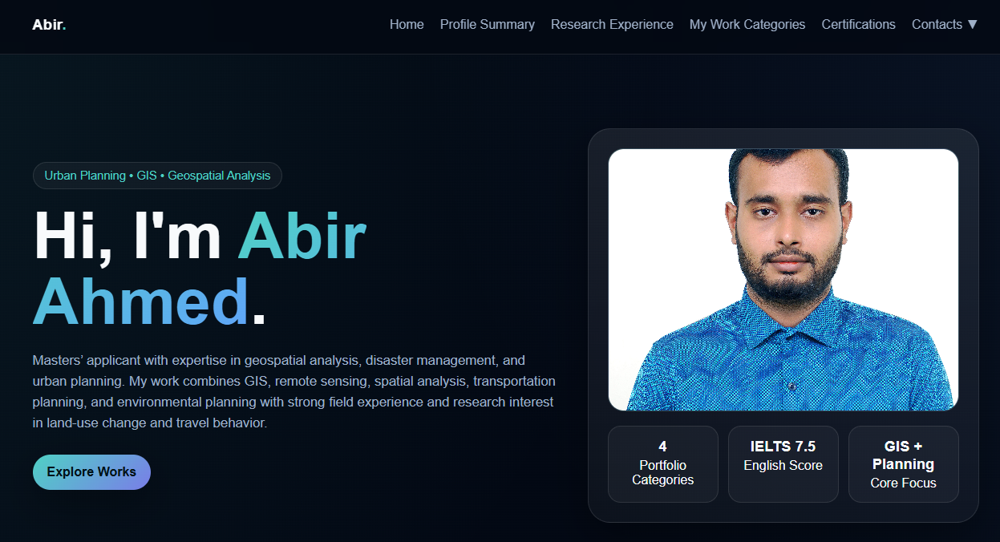

# Abir Ahmed — Personal Portfolio

A responsive personal portfolio showcasing my academic background, professional experience, research interests, GIS and geospatial work, fieldwork, and certifications.

🌐 **Live Website:** [Visit My Portfolio](https://abir-wq.github.io/abir-ahmed.github.io/)

## Overview

This portfolio presents my background in Urban and Regional Planning and my interests in GIS, Remote Sensing, Geospatial Analysis, Environmental Planning, and Spatial Data Science.

It brings together my education, professional experience, research activities, selected work, and certifications in one place.


## Technologies Used

* **HTML5** — Page structure and content
* **CSS3** — Layout, styling, responsive design, and animations
* **JavaScript** — Interactive navigation, image viewer, and expandable content

## Main Features

* Responsive layout for desktop and mobile screens
* Navigation between portfolio sections
* Profile summary and educational background
* Professional experience and project information
* Research and spatial analysis work
* Certifications and supporting documents
* Interactive image viewer for portfolio images
* Contact links for email and professional networking

## Project Structure

```text
abir-ahmed.github.io/
├── index.html
├── README.md
├── abir-ahmed-profile.webp
├── abir-ahmed-profile.png
└── Supporting images, documents, and portfolio assets
```

## Getting Started

This is a static website built with HTML, CSS, and JavaScript.

1. Clone the repository:

   ```bash
   git clone https://github.com/Abir-wq/abir-ahmed.github.io.git
   ```

2. Enter the project directory:

   ```bash
   cd abir-ahmed.github.io
   ```

3. Open `index.html` in a web browser.

For local development, you can also use the VS Code Live Server extension.

No package installation is required for the basic static website.

## Deployment

The portfolio is hosted using GitHub Pages.

**Live URL:** https://abir-wq.github.io/abir-ahmed.github.io/

Updates pushed to the configured publishing source can be deployed through GitHub Pages.

## Contact

* **GitHub:** [Abir-wq](https://github.com/Abir-wq)
* **LinkedIn:** [Abir Ahmed](https://www.linkedin.com/in/abir-ahmed99)
* **Email:** [Contact me](mailto:ahmed.abir.urp17@gmail.com)

---

© Abir Ahmed. All rights reserved.
